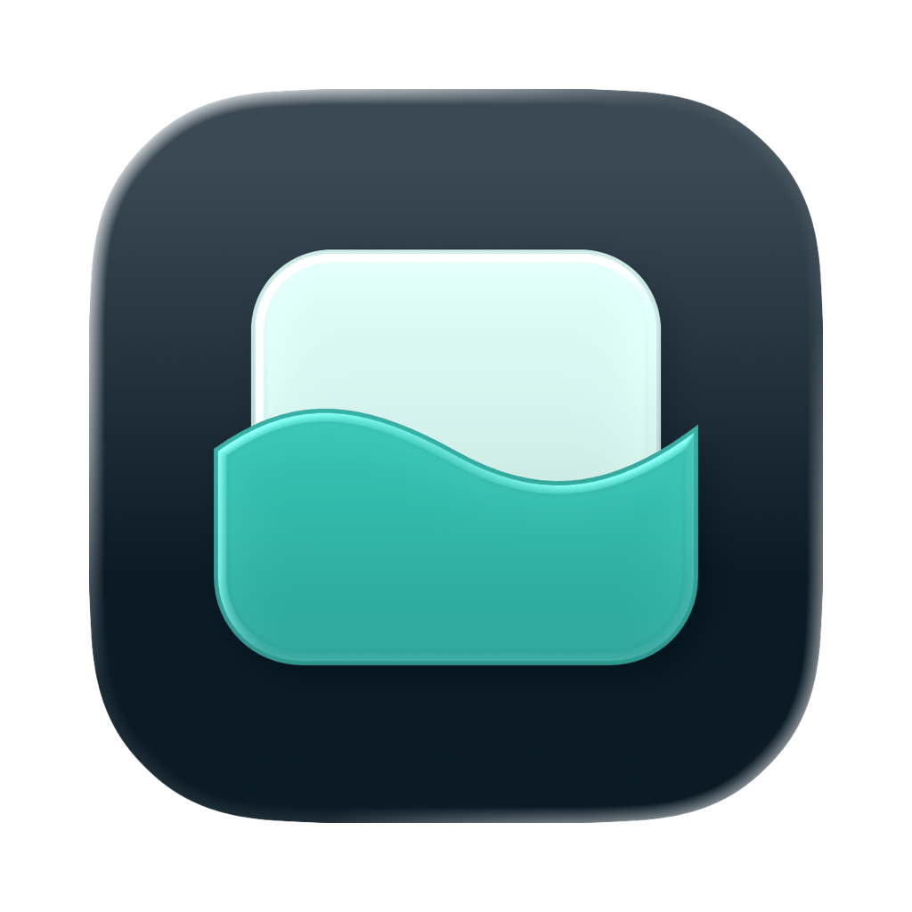
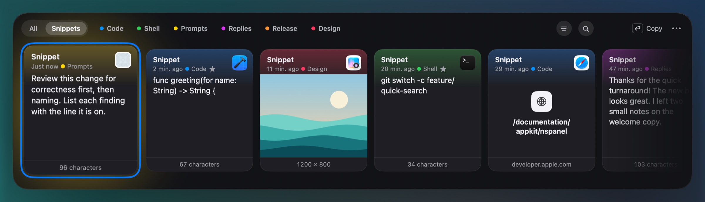
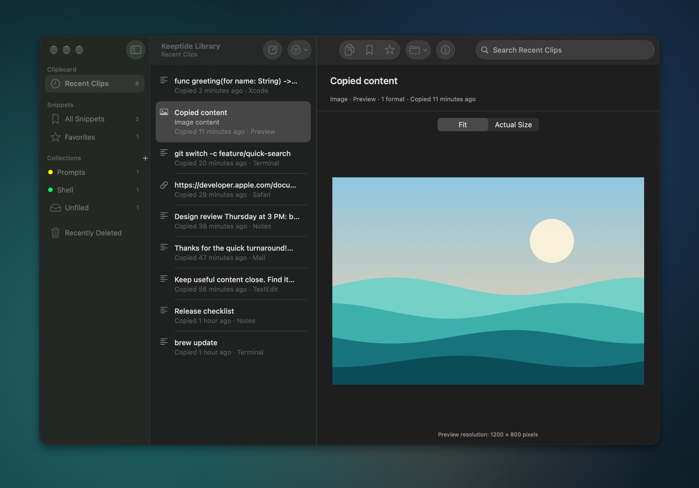

<p align="center">
  
</p>

<h1 align="center">Keeptide</h1>

<p align="center">
  <strong>Keep useful content close.</strong><br>
  A native clipboard history and snippet library for macOS.
</p>

<p align="center">
  <a href="https://github.com/InsightProber/Keeptide/actions/workflows/macos.yml"></a>
  
  
  <a href="LICENSE"></a>
</p>

<p align="center">
  
</p>

Keeptide remembers what you copy, such as commands, code, links, images and
notes, and brings it back with one shortcut. Press ⇧⌘V, pick a card, and press
Return to paste it where you were working. Keep the things you reuse as
snippets in a native library.

> [!NOTE]
> Keeptide is in early development. There is no notarized release yet, and test
> builds are ad-hoc signed. [Status](#status) lists what works today and what is
> still planned.

## Features

- **Remembers what you copy.** From first launch, Keeptide saves new copies
  whenever it is running: plain and rich text, images, links and file
  references, in their original formats. Copying exactly the same content
  again does not create a duplicate. There is no pause switch; quitting
  Keeptide stops it.
- **One shortcut away.** ⇧⌘V opens quick access, a band of cards with the
  newest first. Clips you reuse often sit to the left of the newest one. Click
  **Snippets** at the band's top left to use what you keep on purpose; your
  collections appear beside it.
- **Fast local search.** Start typing to search your clips and snippets,
  including one- and two-character Chinese queries. The filter button beside
  the search, at the band's right end, narrows the list to your favorites or to
  text, links, images or files.
- **Paste where you were.** Return, or a double click, pastes the clip into
  the window you came from, or copies it when direct paste is off. ⇧Return uses
  plain text. When that window changed, or anything is uncertain, Keeptide
  copies instead and says so.
- **Careful with terminals.** Text pasted into a terminal is plain text without
  its trailing newline. A multi-line command, or one with control or invisible
  characters, is confirmed first. Keeptide never runs commands.
- **Snippets you keep.** Save any clip as a snippet or write a new one, edit
  text and Markdown natively, add a snippet to as many collections as you like,
  and mark favorites. Editing a snippet never changes the original copy.
- **Text in images.** ⇧⌘T shows the text in a copied image beside its
  preview, recognized on this Mac with Apple's Vision, line by line or joined
  into paragraphs. Tall screenshots are read in strips, so their small text is
  found. Nothing is recognized until you ask, and an image's card shows when
  its text is being recognized or has been found.
- **Translation.** ⌘T shows a translation of the selected text, or of the
  text in an image, beside its preview, made on this Mac with Apple's
  Translation into the first language in your language list. An image's text
  is recognized first when it hasn't been. Code, links and parts already in
  that language stay as they are. Nothing is translated until you ask, a card
  shows when it is being translated or has been, and when translating again
  fails, the earlier translation stays.
- **You decide what stays.** Ignore specific apps, keep history for a day or
  forever, restore from Recently Deleted, and export your library to a folder.
- **Stays on your Mac.** Keeptide's app sandbox has no network access. Content
  that apps mark as private or transient, such as passwords from a password
  manager, is skipped.

## Install

Keeptide needs **macOS 26 or later** on **Apple silicon**.

1. Download `Keeptide-<version>-macOS-arm64.dmg` from
   [Releases](https://github.com/InsightProber/Keeptide/releases) once a test
   build is published, or [build it yourself](#build-from-source).
2. Open the disk image and drag **Keeptide** to **Applications**.
3. Open Keeptide from Applications. Test builds are not notarized, so macOS may
   block a downloaded copy the first time. If it does, click **Open Anyway** in
   **System Settings › Privacy & Security**.

## Getting started

1. **Launch Keeptide.** It runs from the menu bar. The welcome window explains
   what Keeptide saves and what it skips. From then on, new copies are kept
   while Keeptide is running; what the clipboard already held is not imported.
2. **Copy as usual.** If macOS asks whether Keeptide may read what you copy in
   other apps, allow it. While new copies cannot be saved, quick access and the
   menu-bar menu say why.
3. **Press ⇧⌘V** to open quick access, or choose **Open Quick Access** from the
   menu-bar menu.
4. **Pick a clip.** Press ← or →, swipe on the trackpad, or type to search.
   To use a snippet, click **Snippets** at the top left, then a collection if
   you like, or press ⌘].
5. **Press Return**, or double-click the clip, to paste it into the app you
   came from. Without direct paste, Return copies the clip; press ⌘V to paste
   it yourself.
6. **Optional: turn on direct paste.** Choose **Enable Direct Paste…** from the
   actions menu (⌘K), or **Turn On Direct Paste…** in **Settings › General**,
   then allow Keeptide in **System Settings › Privacy & Security ›
   Accessibility** (**Device Control and Data Access** on macOS 27) and reopen
   Keeptide. **Settings › General** shows whether direct paste is on. Keeptide
   sends the paste; it cannot confirm that the app received it.

### Quick access keys

| Key | Action |
| --- | --- |
| ⇧⌘V | Open or close quick access (change it in **Settings › Shortcuts**) |
| ← → | Move to the previous or next clip |
| ⌘[ ⌘] | Previous or next list: All, Snippets and your collections |
| ⌘L | Go to the list switch |
| Typing | Search the current list; All searches clips and snippets |
| Return | Paste into the app you came from, or copy |
| Double-click | Paste or copy the clip you double-click, as Return does with a clip |
| ⇧Return | Paste or copy as plain text |
| Space or ⌘Y | Show or hide a larger preview |
| ⇧⌘T | Show the text in the selected image beside its preview |
| ⌘T | Show the translation of the selected text, or of the text in the selected image, beside its preview |
| ⌘. | Stop recognizing the text in an image, or translating |
| Return, ⌘C, ⌘S beside the text in an image or a translation | Paste it, copy it (or the part you selected), or save it as a snippet |
| ⌘K or right-click | Show every action for the selected clip |
| ⌘S | Save the clip as a snippet |
| ⇧⌘M | Save the clip into a collection, or add a snippet to one; choosing a checked collection takes the snippet out |
| ⌘D | Mark a snippet as a favorite, or unmark it; a clip is saved as a snippet first |
| ⌘⌫ | Move the clip or snippet to Recently Deleted; ⌘Z puts it back. With text in the search field, ⌘⌫ edits the text |
| ⌘E | Show the clip, or its snippet, in the library |
| ⌘N | Write a new snippet, in the collection you are browsing |
| Esc | Step back: close the text beside the preview, then the preview, clear the search and return to All, then close quick access |

### Library

Choose **Open Library** from the menu-bar menu, or press ⌘E in quick access to
show the selected clip, or its snippet, there.

- **Recent Clips** lists everything Keeptide kept. The toolbar copies the
  selected clip or saves it as a snippet, straight into a collection if you
  like; the Info button shows a snippet's type, collections, favorite and note.
  Images open fitted or at actual size, links open only when you ask, and files
  use Quick Look.
- **All Snippets** and **Favorites** hold what you keep on purpose; your
  **collections** sort them, a snippet can be in several at once, and
  **Unfiled** shows snippets that are in no collection. In a collection, ⌫
  takes a snippet out of it and nothing is deleted. Snippets have native text
  editing, find, a Markdown reading mode, and drafts that survive a restart.
- **Recently Deleted** keeps deleted items for seven days before they are
  removed for good, and you can restore them until then.
- The sidebar shows how many items each list holds. The **Filter** button over
  the list narrows it to favorites, to one kind of content or to the app it
  came from.
- **File › Export Library…** and **Export Selected…** copy the visible list or
  the selected items into a new folder. An export is a local snapshot, not a
  backup you can import.

<p align="center">
  
</p>

### Settings

Choose **Settings…** from the menu-bar menu.

| Tab | What you can change |
| --- | --- |
| General | Card size, how much the selected card grows, faded strip ends, frequent clips, trackpad ticks, whether direct paste is on, opening at login, the welcome window and library export |
| Shortcuts | The quick access shortcut: ⇧⌘V, ⌥⌘V, ⌃⌘V or off |
| Privacy | Ignored apps, how long to keep clipboard history (from one day to forever) and storage warnings |
| iCloud | Shows that iCloud saving is not available in this build |

## Privacy

- Your history lives in a local library on this Mac. Keeptide's app sandbox
  has no network access, and iCloud saving is not available yet.
- Ignored apps, and content that apps mark as private or transient, are
  skipped. A copy larger than 50 MiB, or one whose formats cannot all be read,
  is not kept, and Keeptide says why until a later copy is kept.
- Text in images is recognized, and translations are made, on this Mac. Both
  are kept beside their item in the local library, and are not saved to iCloud
  or exported.
- Clipboard contents are read in a separate sandboxed helper process, so a slow
  or faulty app cannot freeze Keeptide.
- When the disk is full, Keeptide stops saving new copies and says so. It never
  discards what you kept to make room.
- Keeptide never runs commands, and it does not log clipboard contents.

## Status

Development builds include local capture, quick access with lists for
snippets, favorites and collections, search, direct paste, text in images
recognized and text translated on this Mac, the snippet library with
collections (a snippet can be in several), favorites, list counts and filters,
history retention, Recently Deleted and local export.

Planned:

- background iCloud saving and recovery after reinstalling;
- Developer ID signing, notarization and a public release.

Known limits:

- Source app attribution is best effort; it cannot prove which app wrote the
  clipboard. Clipboard contents replaced very quickly may be missed.
- A file reference points to a file on this Mac; it is not a backup of the file.
- The system's Allow / Ask / Deny clipboard permission flow still needs
  dedicated acceptance testing. Automated tests use isolated named pasteboards
  and temporary libraries.

The first release focuses on one Mac; a dedicated multi-device experience is
out of scope. See [Feature scope](docs/features.md) and the
[Roadmap](docs/roadmap.md) for details.

## Build from source

You need full Xcode with the macOS 26 SDK or later. Command Line Tools alone
cannot run the test suite.

```sh
git clone https://github.com/InsightProber/Keeptide.git
cd Keeptide
open Keeptide.xcodeproj
```

Select the shared **Keeptide** scheme and run. The project uses Swift 6 and
Apple frameworks only.

The main developer checks are:

```sh
./scripts/verify.sh all        # native tests, a Release build, warnings as errors
./scripts/verify.sh analyze    # Xcode static analyzer
./scripts/benchmark.sh         # 10,000-item search oracle, 100,000-item benchmark
./scripts/benchmark.sh --million
```

The benchmarks measure the search service in a Release test build with
synthetic items. They do not measure quick access rendering, input latency or
first-frame time. Logs, result bundles and reports stay in the ignored
`.local/` directory. [Contributing](CONTRIBUTING.md) covers focused runs and
validation boundaries.

### Test disk images

```sh
python3 scripts/package_dmg.py --version 0.1.0-rc.1 --build-number 1 --output .local/packages/0.1.0-rc.1
```

The output folder must not exist yet. The disk image holds the app, an
Applications shortcut, installation notes, and the project license and
notices. **These are ad-hoc-signed test builds, not Developer ID-signed or
notarized releases.** Packaging does not enable iCloud. macOS treats each newly
installed test build as a different app, so an earlier build's Accessibility
access does not carry over: if **Settings › General** says direct paste is off
although Keeptide is on in the Accessibility list (**Device Control and Data
Access** on macOS 27), remove it from the list with −, add it again with + and
reopen Keeptide.

- Publishing a GitHub Release, tagged like `v0.1.0` or `v0.1.0-rc.1` on a
  commit already in `main`, makes the **Release DMG** workflow attach the disk
  image, its SHA-256 checksum and build metadata. A tag alone publishes
  nothing.
- Pull requests also build the disk image and check it mounted read-only.
  **Run workflow** makes a downloadable Actions artifact, kept for 14 days,
  without publishing a release.
- Uploading again keeps matching assets and rejects a different file with the
  same name. Retrying only the publication job reuses the verified artifact; a
  different build needs a new version.
- The mounted volume shows the Keeptide icon. The downloaded `.dmg` file itself
  may keep macOS's standard disk-image icon.

## Principles

- Content stays available offline.
- Keeping a snippet protects it from history cleanup, and editing it preserves
  the original capture.
- Storage warnings are visible, and keeping history forever means no automatic
  eviction.
- iCloud, once available, will mirror current content in the background and
  help restore the library after reinstalling. It is not a version history:
  deletions propagate, and unsent local changes cannot be recovered from the
  cloud.
- AI-assisted retrieval and contextual suggestions are a possible future
  direction. The first release concentrates on a reliable, responsive native
  foundation.

## Project documents

| Document | Contents |
| --- | --- |
| [Feature scope](docs/features.md) | Planned first-release capabilities and boundaries |
| [Architecture](docs/architecture.md) | Native interfaces, content storage, search and cloud boundaries |
| [Roadmap](docs/roadmap.md) | Capability milestones and future direction |
| [Contributing](CONTRIBUTING.md) | Contribution workflow, verification and documentation policy |
| [Agent instructions](AGENTS.md) | Shared project guidance for Codex and Claude Code |

## License

Keeptide is licensed under the [Apache License 2.0](LICENSE).
See [NOTICE](NOTICE) for the project copyright notice.
