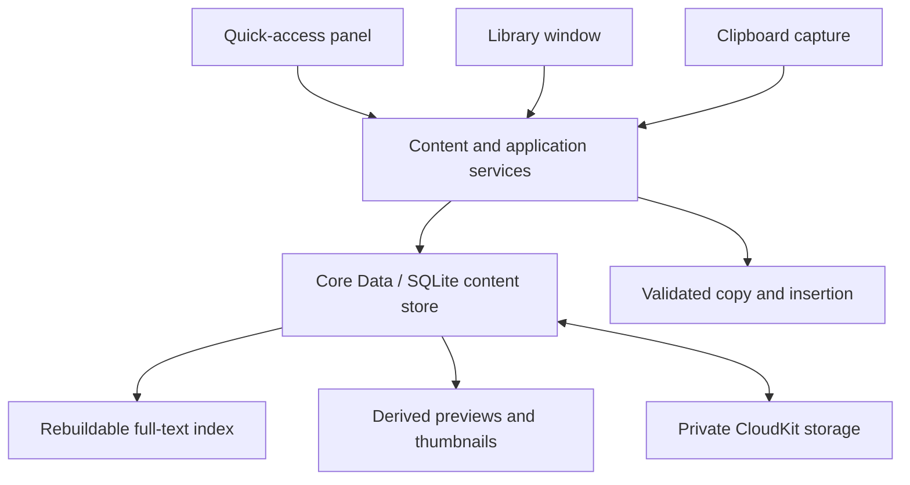

# Architecture overview

Keeptide is designed as a local-first native macOS application. This document
describes the overall architecture. The native shell, local storage foundation,
local clipboard recording, a rebuildable local search index, and quick-access
browsing on a band of clip cards, search, text and image preview, copying, and
direct paste into the app window quick access was opened from are implemented.
Editing, export UI, and cloud integration remain planned.

## Native interfaces

Two interfaces serve different tasks:

- **Quick access** is a compact, temporary panel for searching, previewing, and
  reusing content while working in another application.
- **The library** is a persistent workspace for creating snippets, editing short
  notes, organizing collections, and managing retained content.

SwiftUI provides the interface structure. AppKit supplies native window, focus,
text editing and system integration where those behaviors need precise control.
Both interfaces use the same application services and content model.

## System overview

## Content and persistence

Core Data, backed by SQLite, is the authoritative content store. Metadata and
large content are handled separately so browsing the library does not require
loading every image or rich representation into memory. Portable content and
local-only usage and file access information use separate stores. Atomic content
transactions validate versions and references before committing. Snapshot reads
retain a consistent view while later edits proceed; an unavailable old payload
terminates the snapshot instead of mixing versions. Persistent changes identify
records for downstream consumers without duplicating their bodies.

Clipboard body reads run in a short-lived helper process with the application's
inherited sandbox. The main process observes clipboard versions, applies capture
policy, and admits only the matching read result. Cancellation and shutdown drain
pending capture work before closing storage. Foreground-app attribution remains
observational; permission and source-identity limitations must remain visible.

An original capture preserves the clipboard content and its representations.
A saved snippet can initially reference that capture. Its first body edit creates
independent editable content, preserving the original. Independently created
snippets keep their identity even when their text happens to match.

Repeated captures are deduplicated only when their complete content matches.
Search normalization does not alter stored content or determine content identity.
History retention and saved-snippet lifetime are independent. Content is reclaimed
only when its retention and references permit it.

## Search and previews

Full-text search is a derived SQLite index, rebuilt from the content store when
necessary. It supports literal queries, mixed languages, and complete progressive
matching for short queries. Results carry enough identity and version information
to reject obsolete content before an action is performed.

Previews and thumbnails are also derived. Expensive work runs away from the UI
thread and can be cancelled when the user changes selection. Link and Markdown
previews do not automatically fetch remote resources.

## iCloud and local boundaries

`NSPersistentCloudKitContainer` mirrors portable content into the user's private
CloudKit database. Local edits remain usable offline. Initial recovery validates
content before making it actionable and protects partially restored data from
destructive maintenance.

Cloud activity is reported at the level the platform can establish. A successful
container event is not a receipt for every individual item. Account transitions
must isolate stores and avoid mixing libraries.

Indexes, thumbnails, drafts, usage summaries and local file access permissions
stay on the Mac. File references do not imply that the referenced file itself has
been uploaded. Recovered references may require the user to locate a file again.

## Permissions and reuse

Recording is enabled intentionally. Direct paste uses the system's Accessibility
(send keys) permission, which the user grants in System Settings. Without it,
quick access copies. Quick access notes the app window it was opened from. It
checks the front app and window before it sends a paste and again after the
panel hides. If they changed, or anything is uncertain, it copies the clip
instead and says so. Keeptide sends the paste and does not confirm that the app
received it.

When the target is a terminal, text is pasted as plain text only, and its
trailing newline is removed. A multi-line command needs confirmation first,
because a terminal can run each line as soon as it arrives. **Copy As-Is** in
the actions menu copies the clip complete. The application does not execute saved
commands: the paste is the only keystroke it sends.

## Extension boundary

Stable content identities, versions, change consumption and a shared search
interface allow future semantic retrieval to be added as a derived capability.
The first release does not include embeddings, model inference or background
input monitoring. Future suggestions must preserve the same permission and
content-validation boundaries.
