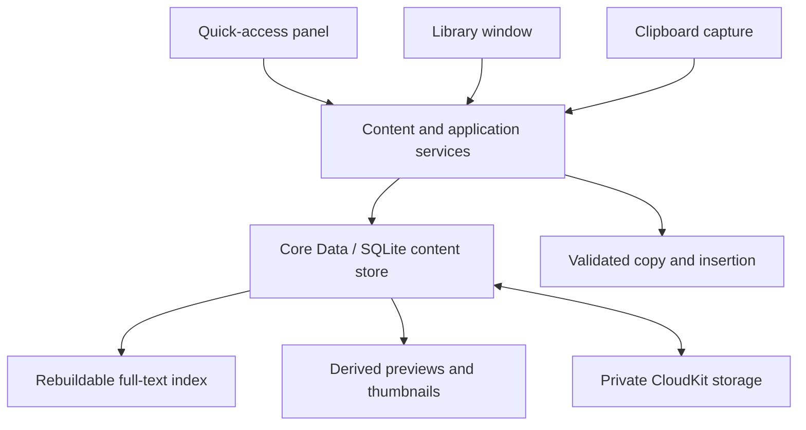

# Architecture overview

Keeptide is designed as a local-first native macOS application. This document
describes the overall architecture. The native shell, local storage foundation,
local clipboard capture, a rebuildable local search index, and quick-access
browsing on a band of clip cards, search, text and image preview, copying, and
direct paste into the app window quick access was opened from are implemented.
The snippet service foundation, including recoverable drafts and conflict copies,
the native snippet editor, and local export UI are implemented. Cloud integration
remains planned.

## Native interfaces

Two interfaces serve different tasks:

- **Quick access** is a compact, temporary panel for searching, previewing, and
  reusing clips and saved snippets while working in another application.
- **The library** is a persistent workspace for creating snippets, editing short
  notes, organizing collections, and managing retained content.

SwiftUI provides the interface structure. AppKit supplies native window, focus,
text editing and system integration where those behaviors need precise control.
Both interfaces use the same application services and content model.

## System overview

## Content and persistence

Core Data, backed by SQLite, is the authoritative content store. Metadata and
large content are handled separately so browsing the library does not require
loading every image or rich representation into memory. Portable content and
local-only usage and file access information use separate stores. Atomic content
transactions validate versions and references before committing. Snapshot reads
retain a consistent view while later edits proceed; an unavailable old payload
terminates the snapshot instead of mixing versions. Persistent changes identify
records for downstream consumers without duplicating their bodies.

Clipboard body reads run in a short-lived helper process with the application's
inherited sandbox. The main process observes clipboard versions, applies capture
policy, and admits only the matching read result. Cancellation and shutdown drain
pending capture work before closing storage. Foreground-app attribution remains
observational; permission and source-identity limitations must remain visible.

An original capture preserves the clipboard content and its representations.
A saved snippet can initially reference that capture. Its first body edit creates
independent editable content, preserving the original. Independently created
snippets keep their identity even when their text happens to match.

Repeated captures are deduplicated only when their complete content matches.
Search normalization does not alter stored content or determine content identity.
History retention and saved-snippet lifetime are independent. Content is reclaimed
only when its retention and references permit it.

The snippet service layer now performs capture saving, independent creation,
copy-on-write edits, and conflict preservation through the same transactional
store. Display types survive reopening and older stores migrate without changing
capture bytes. Local drafts are isolated by library and editing session, written
atomically, and retained when saving fails. Composition and asynchronous saves
are coordinated before changes reach the content store. The native editor uses
those contracts for recoverable editing, document find, search, and explicit saves.

## Retention and safe maintenance

History expiration, recoverable removal and permanent removal are separate
operations. Saved snippets retain the content they reference. Permanent cleanup
records its progress durably across the content and local stores, checks exact
identities and references, and resumes after interruption. Active snapshots
protect payloads they still need, and unknown recovery formats remain preserved.

Storage warnings do not impose quotas. If a write fails for lack of disk space,
Keeptide says so and tries each new copy only as it arrives, and only the
rebuildable search index is eligible for automatic cache removal. Primary
content and drafts remain intact.

## Search and previews

Full-text search is a derived SQLite index, rebuilt from the content store when
necessary. It supports literal queries, mixed languages, and complete progressive
matching for short queries. Results carry enough identity and version information
to reject obsolete content before an action is performed.

Previews and thumbnails are also derived. Expensive work runs away from the UI
thread and can be cancelled when the user changes selection. Link and Markdown
previews do not automatically fetch remote resources.

## iCloud and local boundaries

`NSPersistentCloudKitContainer` mirrors portable content into the user's private
CloudKit database. Local edits remain usable offline. Initial recovery validates
content before making it actionable and protects partially restored data from
destructive maintenance.

Cloud activity is reported at the level the platform can establish. A successful
container event is not a receipt for every individual item. Account transitions
must isolate stores and avoid mixing libraries.

Indexes, thumbnails, drafts, usage summaries and local file access permissions
stay on the Mac. File references do not imply that the referenced file itself has
been uploaded. Recovered references may require the user to locate a file again.

## Permissions and reuse

Keeptide saves new copies whenever it is open, with no pause switch; ignored
applications and privacy filters decide what is skipped. While new copies cannot
be saved, quick access, the menu bar and the library say why. Direct paste uses
the system's Accessibility (send keys) permission, which the user grants in
System Settings. Without it, quick access copies. Quick access notes the app
window it was opened from. It checks the front app and window before it sends a
paste and again after the panel hides. If they changed, or anything is
uncertain, it copies the clip instead and says so. Keeptide sends the paste and
does not confirm that the app received it.

When the target is a terminal, text is pasted as plain text only, and its
trailing newline is removed. A multi-line command, or one with control or
invisible characters, needs confirmation first, because a terminal can run each
line, or act on such a character, as soon as it arrives. **Copy As-Is** in the
actions menu copies the clip complete. The application does not execute saved
commands: the paste is the only keystroke it sends.

## Text recognition and translation

Text in an image is recognized on this Mac with Apple's Vision framework, from
the image's full-size original rather than a card's thumbnail, and off the main
thread. Engines are grouped in three tiers: Apple's frameworks on this Mac, and,
planned, Apple Intelligence on Macs that have it and cloud models a person
chooses. A tall image is read in strips, because Vision only finds text that is
large enough against the region it reads; each paragraph comes whole from one
strip. A shared streaming module runs each request as one job per item and
action, which a newer request replaces, and saves its result once. Recognized
text is derived data, kept beside its item in the local store: it follows the
item into Recently Deleted and back, is removed with it, is bound to the item's
exact content, and is never mirrored to iCloud or exported.

Translation runs on this Mac with Apple's Translation framework. Natural
Language tells each paragraph's language first, after code, links and numbers,
which it misreads, are set aside; paragraphs already in the target language stay
as they are. Every language pair is checked before any text is translated, so a
language to download is named at the start, and the paragraphs in one language
are translated in one session, each sent as it is done. A translation is kept as
recognized text is, one per item whatever its language. A whole result replaces
the one before, even one with nothing in it; a job that fails, or whose result
the store turns away, leaves the earlier one, and so does a stopped one when the
earlier one is whole.

## Extension boundary

Stable content identities, versions, change consumption and a shared search
interface allow future semantic retrieval to be added as a derived capability.
On-device model inference uses only Apple's frameworks, for text recognition,
language identification and translation today. The first release does not include embeddings or background input
monitoring. Future suggestions must preserve the same permission and
content-validation boundaries.

## Local export

Export reads a fixed local snapshot and keeps its source content protected until
publication finishes. Portable originals and readable derivatives are written
to a new directory, then independently checked against the declared content
identities and file digests. Publication uses an exclusive atomic rename and
never replaces an existing directory. This provides verified, atomic publication
while the system is running; it is not a guarantee against sudden power loss.
Local file permissions, bookmarks and reference paths are excluded. Exports do
not claim remote completeness and are separate from future cloud recovery.
